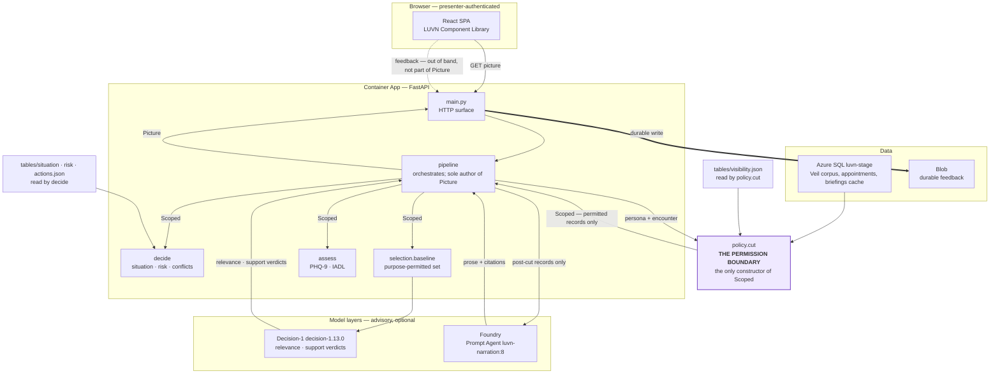

# Decision-Guided Situation Picture

## Architecture as built — LUVN Hackathon Challenge 1.1

**For:** judges, solution architects, developers.
**Status:** describes the system that is **built and deployed**, not a proposal. Synthetic data, modelled
integrations.

**What this document is.** The explanation: what the system does, why it is shaped this way, and where each
guarantee is enforced. `docs/architecture-as-built.md` is the record — the same system plus its evidence
history and what was tried and abandoned. Read this one to understand it; read that one to audit a claim.

---

# What this is

**LUVN** is Länsi-Uudenmaan hyvinvointialue, a Finnish wellbeing services county. Its professionals — nurses,
physicians, social workers, public health nurses — work across separate systems (patient records, medication
lists, assessments, maternity-clinic forms, social-services decisions) that do not show each other's work.
The same client history gets re-read and re-entered at every appointment.

**Challenge 1.1** asks for the opposite: *esitietojen koonti — oikeat tiedot oikealle ammattilaiselle*, the
pre-visit information assembled automatically, showing only what is relevant **and** permitted for this
professional in this situation. The point is zero-touch: no searching, no clicking, no re-entering.

**Concretely.** A nurse is about to see a client for a medication follow-up. Before the appointment, the
screen is already showing the current medications, what changed, what is missing, what needs attention, and
a source citation for every claim — filtered to what a nurse may see for that purpose, and different from
what the physician or the social worker would see for the same person.

**Who is who.** The *professional* is the person the picture is assembled for; their *role* and *purpose* are
what the permission rule keys on. The *client* (also "person" here) is the subject of the records. In the
hosted demo the *presenter* is whoever signed in through Entra — and note the limit: the demo simulates a
role, which is **not** proof that the signed-in viewer is entitled to that role in a real system.

**The roles and purposes modelled** are a small synthetic set, not the real LUVN catalogue:

| Roles | Purposes |
|---|---|
| `laakari` (physician), `sairaanhoitaja` (nurse), `sosiaalityontekija` (social worker), `terveydenhoitaja` (public health nurse) | `medication_follow_up` (Lääkityksen seuranta), `mental_health_assessment` (Mielialan arviointi), `functioning_service_needs` (Toimintakyvyn ja tuen arviointi), `child_health_checkup` (Neuvolan terveystarkastus) |

The same person, opened by the same role, for a different purpose, is a different picture. That is the whole
reason relevance cannot be a property of the record.

---

# The idea in sixty seconds

A professional opens a client's case. Before they have searched, clicked or typed anything, the screen
already shows what they need: the situation, the risk, what plausibly happens next, the facts that support
each claim, and what they are permitted to see.

The hard part is not the summary. The hard part is **deciding what belongs in it**, and being able to defend
that decision afterwards.

So this system puts a **deterministic decision layer between the data and the language model**. Rules decide
what is visible, what is relevant, how urgent it is and what is suggested. The language model is handed that
decision and asked to explain it in Finnish prose. It is never asked what the client's situation is, how
urgent it is, or what should happen.

That single ordering is the whole architecture. Everything else follows from it.

Two consequences are worth naming here, because they are the parts that hold up under scrutiny:

- **The response is one typed object, `Picture`** — the deterministic decision, the permitted records, the
  generated prose, and the evidence for every claim in it. One module authors it. Everything downstream
  renders what it says.
- **A withheld record is never disclosed in any form** — not by name, not as a count, not as a percentage.
  Even the *cause* of an absence is hidden, so the absence itself leaks nothing. This is the single most
  important behaviour in the system; it is [ADR-0004](docs/adr/0004-silent-absence.md), and it is what makes
  the rest of the design defensible.

---

# The contract, first

Six nouns do most of the work in this document. They are defined here so that every later use lands on
something.

| Noun | What it is |
|---|---|
| **`Picture`** | The response. One typed object: the decision (`situation`, `risk`, `actions`, `conflicts`), the permitted records, the generated `narrative` plus its `grounding`, the per-record `selection` reasons, `proposals`, coverage, and a `trace` of which rule fired. Authored in exactly one place. |
| **`policy.cut`** | The permission rule, run **once per request, before any model**. Given a person and an encounter, it returns the records that role and purpose may see. |
| **`Scoped`** | What `cut` returns: *a Henkilö already cut to one Rooli and, when supplied, Palvelukonteksti* — the permitted records plus the role, purpose and encounter they were cut for. `policy.cut` is its only constructor, so no downstream module can widen the set or invent a different permission basis. Before this existed, the cut ran independently in four modules; now it travels as one value. |
| **`pipeline`** | The orchestrator. It calls the cut, drives the deterministic deciders and both model layers in order, and assembles the `Picture`. It is the sole author of the response object. |
| **the seam** | The boundary between the application and its callers — the wire. `Picture` is typed *at* the seam; the internal deciders stay untyped so the wire can stay stable without freezing the decision internals ([ADR-0001](docs/adr/0001-picture-contract-at-the-seam.md), [ADR-0002](docs/adr/0002-grounding-returns-a-typed-result.md)). |
| **Kohtaaminen** (encounter) | One modelled service occasion, binding a person, a role and a purpose. It is *not* a history of previous contacts. A record can carry an encounter or case id, but that is attribution provenance shown on that record — it does not build a timeline. |

One more thing belongs here, because it is a common misreading: **the Finnish wording of every status and
label is owned by the application, not by the model** (the narrative prose itself is model-written, and
renders only if `grounding` accepts it). The model returns enum values (`relevant`, `unclear`, …). The
display strings — `Lääkityksen seuranta`, `ei mallisyötteessä`, `säilyi mallisyötteessä` — are fixed
labelled mappings in the app (`main.py` for purpose labels, the SPA for the Decision-1 outcome lines). A model that
paraphrases cannot change what a status says.

---

# The domain vocabulary

Five Finnish terms carry the architecture. Each is used throughout, so they are set down before their first
use rather than in a glossary at the end. The full list — including `Arvioimaton`, `Kattavuus`, `Lähdeviite`,
`Vastuuhenkilö` and the standing boundary — is in `CONTEXT.md`.

- **Tilannekuva** (the situation picture) — the ready, source-backed pre-visit view assembled for one
  encounter. It distinguishes source facts, dates, missingness and proposals from model narration. It is not
  an autonomous clinical decision.
- **Kirjaus** (record) — one dated, source-identified item of information: a note, medication, diagnosis,
  measurement or form result. It keeps its source and its subject.
- **Palvelukonteksti** (purpose) — *why* this professional needs information now. The same person and role
  differ by purpose, which is why relevance cannot be a property of the record alone.
- **Sallittu / Poissuljettu** (permitted / withheld) — `Sallittu` means eligible for this role and purpose
  under the illustrative rule; it is **not** a model score. `Poissuljettu` is the complement, and it is
  silent: no identity, no count, no cause.
- **Olennaisuus** (relevance) — whether a *permitted* record helps prepare this professional for this purpose.
  A record can be permitted and irrelevant. Relevance can never make a withheld record permitted.

Two more appear in the text below: **Päätös** — an *illustrative*, deterministic situation/risk/action result
that does **not** replace a professional decision — and **Ehdotus**, a bounded, source-linked prompt for
professional review rather than an order.

---

# What the AI is never allowed to do

Stated plainly and early, because this is the part that matters most in health and social care — and because
every line names the component that enforces it, not an intention:

- It never decides **who may see what**. `policy.cut` does, before any model runs.
- It never decides **the situation, the risk level, or the suggested action**. Decision tables do.
- It never **resolves identity or consent**.
- It never **sees a withheld record**, and cannot infer one from a count, a total or a percentage.
- It never **writes** to a source system. Accepting a proposal in the demo is not a clinical order.
- It never produces the **final word**: every generated sentence is checked against its citation, and
  unsupported sentences are dropped rather than shown.

The professional decides. The system proposes, cites and is reversible.

---

# What the system answers, and in what order

Four questions, strictly in this sequence. Each is answered by different machinery, and nothing later may
overrule anything earlier.

| # | Question | Answered by | Can a model change it? |
|---|---|---|---|
| 1 | **What may this role see, for this purpose?** | `policy.cut` | **No.** Never. |
| 2 | **What is the situation, and how urgent is it?** | `decide` over `tables/situation.json`, `tables/risk.json` | **No.** |
| 2b | **What is suggested next?** | the optional `actions` module over `tables/actions.json` | **No** — and it is a module, so the core runs without it |
| 3 | **Of the permitted records, which actually help here?** | Decision-1, a classifier | Yes — advisory only |
| 4 | **How do we say it, with citations?** | Foundry narration, then `grounding` | Yes — advisory only |

If step 1 withholds a record, steps 2, 3 and 4 cannot recover it. That is the invariant the whole design
protects, and it is why the AI can be used ambitiously here: **every model output sits on top of a decision
that was already made without it.**

---

# Architecture principles

Each principle names the module that enforces it, because a principle with no enforcing component is an
intention rather than a description of a built system.

| Principle | Enforced by | If it is broken |
|---|---|---|
| Permission first, relevance second | `policy.cut` is the only constructor of `Scoped`; every consumer receives it and none re-derives it | a record the role may not see reaches a model or the wire |
| Decision before generation | `decide` and `tables/*.json`; `narrative` and `actions` come from different places | a model's sentence becomes the decision |
| Purpose limitation in code, not in a prompt | `policy.cut` reads `visibility.json` before any model call | the model is asked politely to respect a legal constraint |
| Every model layer optional | `llm.foundry_configured`; `/health/ready` depends on neither Decision-1 nor Foundry | a provider outage becomes an application outage |
| A withheld record is disclosed in no form | `policy.cut` removes it; `grounding` rejects any citation outside the permitted-and-selected set | absence leaks by count, total or cause |
| No derived number needs a withheld denominator | coverage is computed over permitted records only | a percentage silently reveals how much was hidden |
| Same data, different lens | one `Persona` envelope; differences come from the cut and the relevance read | parallel pipelines drift apart |
| Citations are checked, not trusted | `grounding.accept_supported_candidate` | a plausible sentence with no support renders as fact |

The boundary "permission first" draws is the **model and the wire**, not the source read: `policy.cut` is applied
in the application, after the person's records are loaded, so a record the role may not see is held in memory
until the cut and is *never* handed to a model, a response or a count. Role-scoping the read itself is
deferred scope, and no document should be read as claiming it.

---

# The three layers

The architectural centre of the system ([ADR-0011](docs/adr/0011-ai-architecture-layers.md)): the
deterministic core keeps authority; both model layers are advisory, and either can be absent.

## Layer 1 — the deterministic core (sole authority)

Plain Python and JSON decision tables. No model.

- **`policy.cut`** decides visibility for the encounter — the only module that decides what a role may see.
- **`decide`** produces the `Päätös`: situation type, risk level and conflicts, from `tables/situation.json`
  and `tables/risk.json`. (`tables/visibility.json` belongs to `policy.cut`, not here.) These tables are the
  product, not scaffolding: they are what makes "rules decide" true and reviewable. **`decide` proposes
  nothing** — suggested next steps are a separate optional module below, and `decide` has no `actions` key
  ([ADR-0023](docs/adr/0023-the-core-proposes-nothing.md)).
- **`actions`** is the **optional** module that answers "what is suggested?". It reads two scalars from
  `decide`'s finished output — situation type and risk level — and evaluates `tables/actions.json`. It never
  receives a record, a persona or a `Scoped`, so it cannot reach data the core did not already decide was
  lawful. `LUVN_ACTIONS_MODULE=0` runs the core alone and the briefing is still complete: situation, risk,
  records and citations are untouched.
- **`assess`** scores structured instruments (PHQ-9, IADL) over the same permitted baseline, from **recorded
  answers only**. Missing answers are never manufactured; supported scores are never a model's guess.
- **`selection.baseline`** picks the purpose-permitted records that belong in the briefing, with a reason per
  record.
- A risk reason travels with its record. `decide` returns `risk_reasons_by_record`, which the picture carries
  through as `Picture.risk_reasons_by_record` and the record view renders as *Riskihavainnon peruste* on the
  record itself, rather than leaving one patient-level label to be explained from memory. Only the rule that
  fired contributes, and a rule with no record behind it (an absence, a count) contributes nothing.

Everything here is reproducible: same input, same output, no tokens spent.

## Layer 2 — Decision-1: the relevance read (the innovation)

**Decision-1 is a classifier, not a generator.** Model `decision-1.13.0`, reached over HTTP with its own key, shaped by a
`state` object (role, purpose) and a `criteria` set. It answers three ways, not two — and the middle column
is the point, because it bounds exactly what an advisory model may change: **Decision-1 can move a permitted record
between the priority and the second tier, remove it from the narration input, or add a permitted, current
free-text record the deterministic baseline missed. It can never add a record to the *permitted* set.**

| Decision-1's answer | Meaning | Effect on the model's input | Where the record shows | Renders as |
|---|---|---|---|---|
| `relevant` | helps prepare this professional here | **added to** it | priority tier, reason `decision:<purpose>:relevant` | promoted into the briefing sources |
| `irrelevant` | judged unneeded | **removed from** it — on a completed, explicit read only | second tier; the professional keeps the record | neutral, `ei mallisyötteessä` |
| `unclear` | Decision-1 abstained, **or** its answer did not clear the deterministic confidence gate (`gate_refused`) | **stays in** it | second tier | neutral, `säilyi mallisyötteessä` |

A withheld record is not in this table at all. Decision-1 is never asked about it.

**The two neutral states matter.** *Abstention is restraint, not a finding*, so neither carries a status
colour — the reader distinguishes them by wording, not by a tint. This is the one place where the UI's
colour rules and the model's honesty meet.

**The two-tier render** is the visible consequence. Priority records and accepted citations come first; every
other selected record stays present in the second tier. Nothing permitted is hidden behind a click — sources,
rationale, coverage and impact are all visible without opening a disclosure.

**Coverage accounting** tells the professional how much permitted free-text evidence was actually assessed:
`assessed`, `gate_refused`, `not_shortlisted`, `budget_exhausted`, `too_long`, `unavailable`. It never reports
a withheld denominator. Two of those names deserve care:

- `gate_refused` means the note **was permitted** but did not clear the relevance gate. It is not a
  permission decision, and it is a different sense of "gate" from the quality gate that checks this
  repository's code.
- `budget_exhausted` is a cap state, assigned only when the candidate index reaches the 80-note cap; with the
  shipped constants the earlier `not_shortlisted` branch always fires first, so **it is currently
  unreachable**. A read that exhausts Decision-1's 30-second wall clock is recorded as `unavailable`, not here.
- `too_long`, `not_shortlisted` and `budget_exhausted` are not reachable through the hosted API today; the
  hosted catalogue surfaces `assessed`, `gate_refused` and `unavailable`. The names are listed because the
  accounting is designed for them, not because all six occur.

### The protocol is a pinned value, not a portal view

Layer 2 is a **typed call**, not an agent: a `state` plus typed `questions`, each a `choice`, `score` or
`noul`, answered with probabilities and usage. That is deliberate and it is recorded as
[ADR-0021](docs/adr/0021-decision-1-stays-a-typed-call.md): an agent may write prose, and an agent never
decides relevance or permission. The owner asked whether serving the decision model through a Foundry
custom agent would make it more transparent; the answer was no, because it would put natural-language
instructions and a free-text intermediate step in front of the per-record probabilities that this whole
layer is audited through.

Transparency is instead bought two ways. `backend/app/decision_protocol.py` describes the protocol — roles,
`state` fields, every question with its wire type and answer vocabulary, and the gates applied to the
answers — and carries a **SHA-256 literal** over the descriptor's canonical JSON that
`backend/tests/test_decision_protocol.py` recomputes. Add a question without touching the pin and the gate
fails. [`docs/decision-protocol.md`](docs/decision-protocol.md) is that descriptor rendered for a reader,
regenerated by `backend/scripts/render_decision_protocol.py`. And the per-record outcome is already in the
`Picture`: the `status`, the probabilities and the rule version for every assessed record, which is what the
audit trace in the UI renders.

What is **not** there yet is a distributed trace. App Insights holds scrubbed app-side stage events only —
no OpenTelemetry spans and no Foundry service-side trace joining the layers — and ADR-0021 records that as
the accepted next step rather than claiming it is done.

## Layer 3 — Foundry: narration (the platform)

Azure AI Foundry, project `proj-default`, model `gpt-6.1-sol`, **Prompt Agent** `luvn-narration:8` — a
versioned agent definition in Foundry.

- **One structured request** over post-cut evidence — no tool loop, no follow-up turns — with at most one
  bounded re-prompt (below). Situation and risk are deliberately *absent* from the narration contract — they render from the
  decision object, never from model text.
- **Two routes, one schema.** A versioned project agent invoked by reference (`agent_reference`) with a
  direct-call fallback. Both validate against the same Pydantic `FreshNarration` schema, so a fallback cannot
  produce a differently-shaped result.
- **Bounded retry.** One deadline-bounded re-prompt on invalid membership or an all-unsupported result, then
  the deterministic briefing renders without prose.
- **Telemetry.** Scrubbed per-stage App Insights custom events. Evaluation and traces inform review; they
  never gate a request.

The latest deployed check recorded `narration_generation_path=agent_reference` with no fallback on that
request. The direct-call fallback is real and does fire: it was used on 3 of 26 recorded generation-enabled
trial calls.

---

# From appointments to a ready briefing

The three layers describe one picture. This section is how the picture is ready **before** the professional
clicks — the zero-touch claim as a data path, not a slogan.

1. **Appointments.** The loader writes the release's scheduled occasions to the SQL `appointments` table
   beside the corpus, each joined to the lens (`encounter_id`) that opens it. `GET /api/worklist` is the day
   view's read: one day's rows for a role, straight from `appointments` and the briefings cache — no record is
   read and no pipeline runs. Each row carries `readiness` (`ready` or `pending`) and the cached `attention`
   summary; urgent contacts sort first, in the source's own words.
2. **The briefings cache** (`backend/app/briefings.py`, the `briefings` table). A built `Picture` is stored
   under `BriefingKey` — the encounter, the corpus generation the loader stamped, the selection
   `RULE_VERSION`, and `agent_version()`, which folds in the narration agent (`LUNA_FOUNDRY_AGENT_NAME`:`…_VERSION`),
   the decision model and `PREFILL_VERSION`. `today` is stored **beside** the row, not in the key: a picture
   built for another date is stale, and `is_fresh` says so. The stored object is the post-`cut` picture the
   route would have built; the route still authorizes and writes its audit row on every read, and answers
   `X-LUVN-Briefing-Source: cache` or `built`. The fixture and delivery-directory backends get no cache
   unless `LUVN_BRIEFING_CACHE=memory`.
3. **The warm-up job.** `python -m app.warmup --days N` reads the coming days' appointments, keeps the ones
   that open a lens, and builds every briefing that has no fresh row, `--concurrency` at a time; a failed
   encounter is counted, never fatal, and nothing is ever deleted. It runs as the Container Apps job
   `luvn-warm-briefings` on the app's own image and identity, scheduled at 04:00 UTC (the schedule lives in
   Azure, recorded in `HANDOFF.md`, not in this repository), and is started by hand after a corpus load — the
   generation is in the key, so a reload empties the cache in effect. A request that misses builds the same
   picture once, through `briefings.build_and_cache`, and stores it.
4. **The pre-fill stage** (`backend/app/prefill.py`, run by `pipeline` after the cut; the flagship). Two
   levels. **Level 1** fills the county's own esitieto headings (*Tulosyy ja esitiedot* … *Toimintakyky*)
   deterministically from the permitted records' note sections and structured rows — no model, every item
   citing its record, an unanswered heading rendered *Kysy vastaanotolla*. **Level 2** pre-fills the official
   forms declared for the purpose (`FORMS_BY_PURPOSE`) with one strict-schema `gpt-6.1-sol` call per form,
   extraction only; **every** answer is then verified by Decision-1 against exactly the records it cites
   (`decision_model.verify_narration`), and an unverified answer is downgraded to `unknown`, never shown.
   `PREFILL_VERSION` is part of the cache key, so a changed pre-fill is a different briefing.
5. **The assistant** (`backend/app/assistant.py`, Avustaja; [ADR-0027](docs/adr/0027-the-tool-using-assistant-supersedes-the-deterministic-arm.md)).
   A tool-using agent over the **cached** picture: its six tools (`list_records`, `get_record`, `get_esitiedot`,
   `get_prefilled_forms`, `get_engine_assessment`, `search_knowledge`) are closed over the built `Picture`, so
   it cannot read anything the cut did not admit. It runs on the Responses API (`gpt-6.1-sol` refuses function
   tools on chat completions), and `POST /api/encounters/{id}/chat/stream` streams it as SSE: `progress` and
   `tool` events, each sentence only **after** Decision-1 verified it, then one `turn`. Raw model text is
   never streamed.

---

# Grounding: who decides the prose may render

This is worth its own section because it is the safety mechanism, and it is split in two:

1. **Decision-1 asks the question.** For each generated sentence, is it supported by the records *cited for that
   sentence*? Decision-1 returns an advisory verdict per sentence — `supported` or not.
2. **`grounding` decides deterministically.** `validate_fresh_candidate` requires every cited record to be in
   the role/session-permitted **and** selected set, and every proposal id to be allowed.
   `accept_supported_candidate` requires each sentence to carry exactly one unique `supported` verdict backed
   by ids drawn from that sentence's own sources. A sentence that is empty after trimming is dropped — so
   blank prose cannot render under a green badge — and if **no** sentence survives, the candidate is rejected
   and no prose renders at all.

A candidate that fails membership validation, or that loses every sentence, is dropped whole and the
structured decision renders directly. A candidate that loses only some sentences renders the survivors, with
the dropped ones listed in `grounding.rejected_sentences`. **The model supplies evidence; deterministic code
holds the pen.** Actions are not checked here at all, because they render from
the decision object and never from model text.

---

# High-level architecture



Read the highlighted box as a wall, not a step. It is drawn outside the application box deliberately: every
arrow into `decide`, `selection`, Decision-1 or Foundry carries `Scoped` or records drawn from it — `assess`
receives the permitted record list — and none of them can reach the persona store. The only ways past the wall are the permitted records themselves.

Note too what is drawn and what is not. The decision tables feed `decide` and `visibility.json` feeds the cut
— they are the reason the deterministic claims are true, and they were missing from the first version of this
diagram. Feedback is **out of band**: the browser posts it to the app, which makes the durable Blob write, and
it contributes nothing to a `Picture` — which is why its edge is dotted.

---

# Opening a case, step by step

```mermaid
sequenceDiagram
    participant P as Professional
    participant SPA as SPA
    participant PL as pipeline
    participant C as policy.cut
    participant D as decide
    participant A as assess
    participant S as selection
    participant J as Decision-1
    participant G as grounding
    participant F as Foundry

    P->>SPA: open an encounter (role + purpose)
    SPA->>PL: GET /api/encounters/{id}/picture
    PL->>C: cut(persona, encounter)
    C-->>PL: Scoped — the permitted records only
    Note over C: withheld records are gone from here on
    PL->>S: baseline over the permitted set
    S-->>PL: briefing records + a reason each
    PL->>D: decide(scoped)
    D-->>PL: situation, risk, conflicts, actions (no model)
    PL->>J: classify permitted notes
    J-->>PL: relevant / irrelevant / unclear, + coverage
    PL->>F: narrate(post-cut records only)
    F-->>PL: prose + citations
    PL->>J: is each sentence supported by its own citations?
    J-->>PL: supported / unsupported, per sentence
    PL->>G: accept the candidate — deterministically
    G-->>PL: every citation permitted AND selected, one unique support per sentence
    Note over G: a failed candidate is dropped whole; survivors render, dropped ones are listed
    PL->>A: score permitted instruments for the Picture
    A-->>PL: PHQ-9 / IADL from recorded answers, others unscored
    PL-->>SPA: Picture
```

Every decider — `decide`, `assess`, `selection`, and both model layers — is reached *through* `pipeline`,
and every one of them receives only the `Scoped` value. That is the "sole author" claim made visible.

---

# What the professional actually sees

`Picture` is the external contract, authored in exactly one place (`pipeline`) and typed at the seam. The
fields below are listed in the order a reader meets them, with the module that computes each — so the table is
also a map of where to look when something is wrong.

| Field | Computed by | What it is |
|---|---|---|
| `identity_header` | `source` | who this is — or a neutral "not available", never a guess |
| `situation`, `risk` | `decide` | the deterministic `Päätös` |
| `actions`, `conflicts` | `decide` | suggested next steps; detected medication/note conflicts |
| `records` | `selection` + `policy` | the two-tier briefing: priority records first, the rest still reachable |
| `selection` | `selection` | why each record is here, per record — plus coverage accounting |
| `narrative`, `grounding` | `narration` + `grounding` | the generated prose, and the result of checking it |
| `citations` | `grounding` | the union of permitted, selected records that at least one accepted sentence cited — per-sentence attribution stays inside the check and is not on the wire |
| `proposals` | `proposals` | bounded, source-linked suggestions to accept, edit or dismiss |
| `duplicate_facts` | `pipeline` | the same keyed fact seen on two forms, unmerged, both shown |
| `form_catalogue` | `pipeline` | the forms expected for this purpose and life stage, each with a presence / due status |
| `assessments` | `assess` | PHQ-9 / IADL scored from recorded answers, plus any other supplied instrument emitted unscored (`valmis=false`) rather than guessed |
| `pipeline_trace` | `telemetry` | per-stage timing, model, tokens, status |
| `trace` | `decide` | which decision-table rule fired, and on what |
| `grounded` | `grounding` | whether prose was accepted at all — the UI renders this as its grounding badge |

**Nothing permitted is hidden behind a click.** Sources, the reason each record is present, coverage and the
impact line are all visible without opening a disclosure. Four disclosures are collapsed by default — a long
full-text excerpt, the pipeline-rule trace, a proposal's evidence, and the run specifications, which are last.

---

# Where it runs

| Piece | Choice |
|---|---|
| Compute | Azure Container Apps, single revision, `minReplicas` 2 / `maxReplicas` 4 (see the deployment record for the captured sizing) |
| Auth | Entra ID presenter authentication — browser requests redirect to Entra; API requests get 401 |
| Registry | Azure Container Registry; image pinned by digest, deployed by targeted `az containerapp update` |
| Feedback | Azure Blob, durable. A hosted acknowledgement is only sent after durable creation — never a silent fallback to local JSONL |
| Telemetry | Application Insights, app-side scrubbed custom events |
| Secrets | Key Vault through the Container App's user-assigned managed identity |

**Readiness is independent of the AI** — it means the deterministic briefing can render. `/health/ready`
checks the served static assets and nothing else; Decision-1 and Foundry are optional stages, not application
dependencies. A provider failure is a degraded view, not an outage.

---

# The UI layer

A React single-page app (Vite) with three destinations in the library's `AppShell`: **Työpäivä**, the day
view — one day's appointments for the active role from `GET /api/worklist`, each row saying whether its
briefing is ready; **Tilannekuva**, the briefing for one encounter, opened from the day, from search or from a
deep link; and **Tekniset tiedot**, the run specifications and build revision, a utility destination outside
the professional's path (being made a dedicated page reached with `?page=technical`). A bare address lands
on the day.

It is styled from a **vendored, checksum-pinned copy of the LUVN Component Library** — `@luvn/component-library`
at commit `014b02a`, under `frontend/vendor/comp-lib/`, the UI authority per
[ADR-0026](docs/adr/0026-the-luvn-component-library-is-the-ui-authority.md) as amended by
[ADR-0028](docs/adr/0028-the-library-pin-moves-to-014b02a-and-the-rehearsal-copy-is-retired.md), which moved
the pin and retired the rehearsal copy; ADR-0026 supersedes
[ADR-0016](docs/adr/0016-swiss-1-foundations-is-the-ui-authority.md)'s vendor choice and retains its contract.
The app takes the shell (`AppShell`, `Header`, `Sidebar`, `BottomNav`, `NavItem`), the tokens, the type roles
and the adopted components from the pin, with its own components held to it by the gate.

The point of pinning it is that the UI cannot drift from the design authority: the app consumes the library's
tokens and named type roles, and a gate refuses raw hex, off-scale lengths, raw font values and primitive
token references. Theme selection lives on `<html>` and is applied by an inline script before first paint, so
dark mode does not flash. A `?capture=1` mode gives a stable DOM for screenshot comparison.

---

# Honest limits

This is a working system built on synthetic data. The following are true of it:

- **The data is synthetic.** No real patient data, no real integrations. Source connections are modelled.
- **The policy rules are illustrative** — not law, not LUVN guidance, and not clinically validated
  thresholds. They demonstrate a governed mechanism, not the mechanism a production system would use.
- **The permission model is not proof of authorization.** A simulated role in a demo is not evidence of an
  authenticated viewer's real entitlement.
- **The relevance classifier is a bounded reader, not a validated instrument.** It is useful, governed and
  accounted for; it is not a clinically calibrated model, and the synthetic evaluation artifacts below do not
  make it one.
- **The Veil corpus is loaded, not validated.** The delivery (404,684 records, 27,910 appointments, 15,000
  people) is in Azure SQL and is what the live app reads; its field aliases are the loader's, and no clinical
  review of the mapping exists.
- **The evaluation artifacts are synthetic and unadjudicated** — a four-case scorecard and a live encounter
  trial, not Foundry Agent Service batch evaluations or clinical accuracy results.
- **No clinical validation exists**, and none is claimed.
- **Two safety branches have never fired in the hosted system.** The one bounded re-prompt and the
  content-filter terminal branch are covered by stubbed tests only; no live rejection or filter block has
  been forced or observed. They are described here as built, not as demonstrated.
- **The hosted narration prompt is server-side.** Editing `backend/app/prompts/narration_instructions.md`
  does not change the `agent_reference` path, which uses the versioned agent definition. The repository
  prompt and the deployed agent are two different artifacts.

Naming these is part of the architecture, not a disclaimer bolted on. A system that governs visibility this
carefully should be equally careful about what it claims.

---

# Where to look in the code

| Concern | Module |
|---|---|
| HTTP surface, readiness, the worklist and stream routes | `backend/app/main.py` |
| The briefings cache and its key | `backend/app/briefings.py` |
| The warm-up job (`luvn-warm-briefings`) | `backend/app/warmup.py` |
| The pre-filled esitiedot (`PREFILL_VERSION`) | `backend/app/prefill.py` |
| The assistant — tools over the cached picture | `backend/app/assistant.py` |
| The `appointments` and `briefings` schema | `backend/app/sqldelivery.py` |
| The pipeline — orchestrator and sole author of `Picture` | `backend/app/pipeline.py` |
| **The permission boundary** (`cut`, `Scoped`) | `backend/app/policy.py` |
| Deterministic decision + the rule tables | `backend/app/decide.py`, `backend/app/tables/` |
| Relevance selection | `backend/app/selection.py`, `backend/app/decision_model.py` |
| **The decision protocol, pinned as a value** | `backend/app/decision_protocol.py`, rendered to [`docs/decision-protocol.md`](docs/decision-protocol.md) |
| Grounding and citation checks | `backend/app/grounding.py` |
| Narration owner | `backend/app/narration.py` |
| Foundry adapter — the LLM seam | `backend/app/llm.py` |
| Source field accessors — the seam for source field names | `backend/app/source.py` |
| The record/person envelope | `backend/app/upm.py` |
| Structured assessments, proposals | `backend/app/assess.py`, `backend/app/proposals.py` |
| Delivery importer | `backend/app/delivery.py` |
| Wire contract | `backend/app/picture.py` |
| UI | `frontend/src/App.jsx`, `frontend/src/DayView.jsx`, `frontend/src/ChallengeDemo.jsx`, `frontend/src/ChatPanel.jsx`, `frontend/src/styles.css` |
| The vendored design library, pinned at `014b02a` | `frontend/vendor/comp-lib/` (`PROVENANCE.md`) |

---

# Decision records

The reasoning behind each choice is in `docs/adr/` ([index](docs/adr/README.md)). The ones that shape this
document:

| ADR | Decision |
|---|---|
| [0001](docs/adr/0001-picture-contract-at-the-seam.md), [0002](docs/adr/0002-grounding-returns-a-typed-result.md) | `Picture` is typed at the external seam; internal deciders stay untyped |
| [0003](docs/adr/0003-empty-evidence-is-unassessable.md) | Empty evidence is `arvioimaton`, and grounding needs a citation |
| [0004](docs/adr/0004-silent-absence.md) | **Silent absence** — a withheld record is not disclosed in any form |
| [0005](docs/adr/0005-residual-disclosure.md) | Cause-neutral absence wording |
| [0008](docs/adr/0008-challenge-1-1-purpose-aware-briefing.md) | Purpose-aware pre-visit briefing |
| [0009](docs/adr/0009-decision-purpose-relevance-selection.md) | Decision-1 as bounded reader and support verifier |
| [0011](docs/adr/0011-ai-architecture-layers.md) | **The three-layer AI architecture** |
| [0021](docs/adr/0021-decision-1-stays-a-typed-call.md) | **Decision-1 stays a typed call** — no agent wrapper; the protocol is pinned and published instead |
| [0013](docs/adr/0013-case-process-binding-and-inherited-restriction.md) | Case context and inherited restriction |
| [0016](docs/adr/0016-swiss-1-foundations-is-the-ui-authority.md), [0026](docs/adr/0026-the-luvn-component-library-is-the-ui-authority.md), [0028](docs/adr/0028-the-library-pin-moves-to-014b02a-and-the-rehearsal-copy-is-retired.md) | The vendored library is the UI authority; **0026 supersedes 0016's vendor choice** and retains its contract; **0028 moves the pin to `014b02a`** |
| [0027](docs/adr/0027-the-tool-using-assistant-supersedes-the-deterministic-arm.md) | The tool-using assistant over the cached picture supersedes the deterministic arm |
