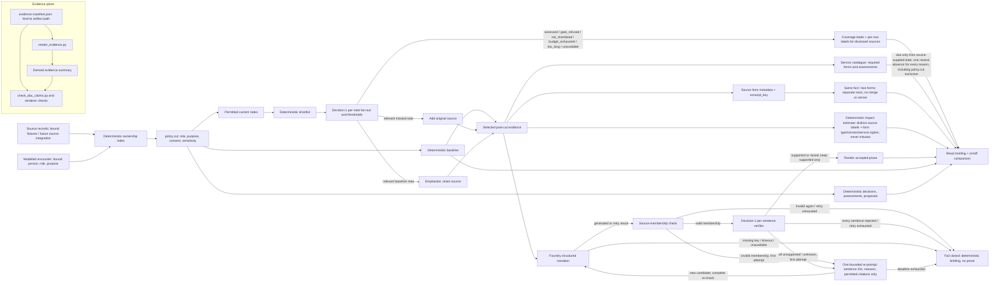
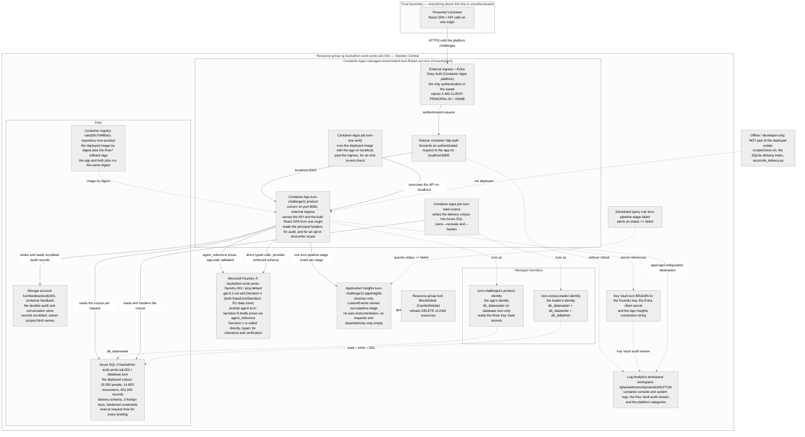

# LUVN Challenge 1.1 — implemented architecture and Decision-1 relevance contract

**This document is the detailed record** — every stage, its evidence, and how each claim was verified. For the same system explained plainly, with diagrams, read [`ARCHITECTURE.md`](../ARCHITECTURE.md) first.

**Status, 2026-10-11 (review-contract round deployed).** The synthetic product demo is deployed as `luvn-challenge11-product` behind Entra presenter authentication. **The currently deployed revision is `luvn-challenge11-product--night5`** — image `sha256:f01024b526caa5057926969cbbca03d4a557a10a12dfac68b3a19d9e3e0104b9`, source commit `2aebda44606b77bfd1287c66a3be1ad8599bf100`, `Provisioned` / `Healthy`, 100% traffic, `minReplicas: 2`, `maxReplicas: 4`, shipped by a targeted `az containerapp update`, not a template. **`luvn-challenge11-product--night5` carries the night of 2026-10-14 and the owner's morning rulings (`--night1` to `--night4` were the same morning's earlier cuts, replaced within hours): Decision-1's findings as blue information rows in the attention panel (what it added, what it put first, what it called relevant and current), the ordering caveat off the chips; and: the doctor sees the whole clinical record, a result from the last year is baseline in every view, the generic fallback step and the catalogue-absence rows are gone, clinical appointments open the doctor lens on the day view, and the open-esitiedot question is answered from the picture; also: the assistant as a right-docked side pane on every destination, the diagnoses table folded to one row per code and status with the historical medications behind a disclosure, plain-Finnish lab labels, a five-to-seven-sentence source-grounded summary on narration agent version 12, a Käypä hoito question that publishes the guideline citation beside the verified sentence, and the doctor lens (`laakari`, mielenterveyden arvio) in the loaded corpus (20,650 encounters). Its predecessor `luvn-challenge11-product--closeout2` carries the close-out of 2026-10-14: the component library at the ADR-0028 pin with the library's own `AppShell`, tables and blocks (ADR-0028); the tool-using assistant as the only conversational surface, the keyword route deleted (ADR-0027) and the opening prompts derived from the attention summary; knowledge retrieval over Azure SQL `VECTOR(1536)` with `text-embedding-3-large` (514 chunks loaded, token-overlap fallback when unconfigured); a 30 s Decision-1 stage with 10 s calls inside a 160 s preparation window; same-day home-care visits folded in the social baseline; the dedicated Tekniset tiedot page, accept/edit on the pre-filled form, Decision-1's time-sensitivity on the day and the briefing, warm-up readiness on the day view, and the tester findings C1–C4 closed. Its predecessor `luvn-challenge11-product--responses` carries the browser-pass rounds on the final product: the assistant's tools run on the Responses API (`gpt-6.1-sol` refuses function tools on chat completions), any encounter opens from the day, from search or from a deep link beyond the catalogue page, the day keeps readiness honest across days, duplicates fold, decisions read as plain text, and the phone layout holds at 390 px; four tester passes closed with no open UI finding. Its predecessor `luvn-challenge11-product--0000102` carried the first browser pass: landing on the day, readiness kept honest across days, duplicate facts folded, and plain-text decisions. Its predecessor `luvn-challenge11-product--main` was the `main` of 2026-10-13 deployed, so the running revision and the repository agreed: it carries the enforced no-first-party-lint-warning invariant, the conversation reset as the mount key's job, and the provenance ledger that names every vendored file's source. Its predecessor `luvn-challenge11-product--nextsteps` stops the assistant refusing the question whose whole purpose is the engine's next steps: the words that make a question procedural -- `toimenpiteitä`, `suosittelet`, `seuraavat`, `mitkä` -- were missing from the vocabulary that decides it, so asking what to do next named a "topic", and because the engine's steps cite nothing by design the answer was refused. Its predecessor `luvn-challenge11-product--agent9` activates narration agent version 9, whose instructions are the corrected ones — the created version's canonical-prompt-sha256 matches the prompt file in this repository, so the hosted agent and the code now impose the same ordering. Its predecessor `luvn-challenge11-product--fix503` carried the HTTP probes and the readiness fix that ended the deployed-only 503 on the briefing path: readiness now probes the data layer while liveness deliberately does not, both probes are HTTP rather than TCP, and the corpus-generation lookup can no longer withhold a briefing it was only meant to enrich. Its predecessor `luvn-challenge11-product--0000095` carried the full-throttle decision model: every permitted record connected to the encounter — of every type and whatever its temporal status — reaches Decision-1, whose verdict now adds or emphasises a structured or historical record instead of being discarded. Measured live, the model is exercised on 14 of 14 sampled encounters, up from 13%. Its predecessor `luvn-challenge11-product--0000094` widened the pool to every permitted type, removed the shortlist cap and stopped a verdict being discarded by record type, and `luvn-challenge11-product--0000093` carried the single-encounter metadata route (ADR-0025 §4) and the refusal of a cursor parameter it does not implement. Its predecessor `luvn-challenge11-product--0000092` carried the loaded corpus itself: the full 2024-2026 cohort is live (14,803 encounters, 11,220 people with an encounter, 401,340 records) and the briefing read now requires an actor and writes one metadata-only audit row. Its predecessor `luvn-challenge11-product--0000090` carried the worklist projection, the lens gate and the chunked loader, and `luvn-challenge11-product--0000088` carried the knowledge-advice rounds, the design-system keyboard fix and the challenge-release corpus tooling, and `luvn-challenge11-product--0000087` before it carried the blood-pressure round. One revision exists between them and never served: `--0000089` was created from an image digest that was not in the registry, was never healthy, and was replaced within minutes (see the plan, §12).** — the engine can see a blood pressure at all for the first time (`systolic_max`/`diastolic_max` from the measurement records, and a `risk-verenpaine-korkea` rule at 140/90 marked `illustrative_threshold`), and the optional actions module is fed the core's matched **risk rule id** — still one of the core's own outputs and still never a record — so five step sets are keyed to what the core actually found. The owner's own 158/92 case now answers with four blood-pressure steps, each carrying `Riski: Verenpaine 140/90 tai yli (havainnollistava raja)` and the table's illustrative status. **One gap is recorded rather than closed:** the reason is traceable to the rule, not yet to the measurement record, because `decide._risk_reasons_by_record` does not yet key this rule. **Rounds, each named beside the revision that carried it beside the revision that carried it (demoted out of the current-state sentence, so no round description is left under a moving revision number):** `luvn-challenge11-product--0000086` carried the **next-steps round** — the assistant answers with the engine's own next steps whenever the situation has them, whatever the question, led by the block and each step carrying its applicability and the actions table's own status (*Havainnollistava sääntö, ei kliinisesti kalibroitu eikä hyväksytty käyttöön*); the turn reports how many sources it cited against the set the digest sealed; an answered turn ends with follow-ups so it does not dead-end; and **`LUVN_ACTIONS_MODULE` is on again** — it had been set to 0 since the Challenge 1.1 round, which is why the live answer to "Mitä toimenpiteitä suosittelet" carried no recommendation at all. Two product oracles reviewed the direction first and both refused model-authored clinical steps until the declared purpose is rewritten in the same change; that remains open.; `luvn-challenge11-product--0000085` carried the **workspace-column rollback** — the record row's columns were restored to the assignment the "Challenge 1.1 unmistakable" round changed: the attention panel, the medications card and the rule-based assessment in the side column, the proposal and the purpose-ordered record cards in the reading column, and the proposal and the assistant in the rail. Measured at 1540×862 before the rollback, the side column held one 155px card beside a 2164px row (93% empty) and the same material stacked in one 492px column made the row 872px taller than the previous UI. The rollback reverses that round's reading order, which is now stated in the code and pinned by test rather than left implicit.; `luvn-challenge11-product--0000084` carried the **assistant-presentation round** — a rule's *proposal* now reads as a proposal in the tag (`Sääntöpohjainen arvio (ehdotus)`, the engine's own label) instead of sharing the finding's tag with the distinction buried in a caption; each finding is labelled in the source's own words (the record's `otsikko`, `lääke`, `tutkimus`, `nimi`, `instrumentti` or measurement, or the engine's own em-dash leading clause) and the statement is rendered without the clause the label duplicates, so the row reads as a label and a sentence rather than a label over a sentence that repeats it; and `BUILD_REVISION` is baked into the bundle so the technical disclosure can say which build the tab is running. The refusal reasoning round 1 published is corrected in the same round: `CHAT_INSTRUCTIONS` rule 3 constrains the generator, not the surface, and the challenge asks for proposals the professional decides.; `luvn-challenge11-product--0000083` carried the **chat-transparency round** — a rule output on the assistant rail now carries the same `Havainnollistava sääntöraja, ei kliinisesti kalibroitu` qualification the briefing has always rendered, and the idempotent-retry path no longer loses it (`statement_rows` wrote `basis` into the stored turn and `turn_from_record` did not restore it); the reply states its own composition and says that a count of displayed statements says nothing about the extent of the record set; the four statement-class tags get a collapsed legend; and down-arrow in the composer completes the field from the encounter's own offered questions. This round also triaged the UpToDate scout item by item — `.scratch/chat-and-suggestions/uptodate-implementation.md` records what shipped, what was already implemented in the surface the scout would have changed, and what was refused with its reason.; `luvn-challenge11-product--0000082` carried the **Challenge 1.1 scope round** — the served corpus drops the two contact records the 1.2 exclusion refused (`demo-p2-visit-1`, `demo-p6-visit-1`, so the flagship contrast is 5 vs 6 and still differs by exactly `demo-p6-3`), the loader's `StorageStreamDownloader.chunks()` crash is fixed, and `LUVN_ACTIONS_MODULE=0` runs the core alone so the generic action strings are gone while source-cited proposals remain.; `luvn-challenge11-product--0000081` carried the **urgency-legend round** — the classifier's own leading urgency level is shown in words beside the distribution it already returns, under a label that names its own limit (*järjestysperuste, ei hoidon kiireellisyys*); the legend is rendered into `docs/decision-protocol.md` from `app.decision_model.URGENCY_LEVELS` and pinned from both the backend and the frontend, and ADR-0023's false claim that Decision-1 does not answer an urgency question is corrected (ADR-0024); this revision also carries the concurrent knowledge-source workstream's runtime changes — guidance/assess/knowledge registry and the risk-tier table; `luvn-challenge11-product--0000080` carried the **core-proposes-nothing round** — `decide` no longer evaluates the actions table and returns no `actions` key; suggested next steps moved to the optional `app.actions` module, which reads two scalars from the core's finished output and defaults on (`LUVN_ACTIONS_MODULE=0` runs the core alone); each risk reason now travels with the record that produced it as `risk_reasons_by_record`, rendered as *Riskihavainnon peruste* on the record; and the chat and guideline surfaces receive the built `Picture` instead of the post-cut permitted set, so they can no longer cite a record the briefing calls irrelevant (ADR-0023); `luvn-challenge11-product--0000079` carried the **greeting round** — the greeting derives a display name from the principal instead of printing the user principal name (it rendered `Hei juhis.jalopeura@ecdx.onmicrosoft.com,`), and the derivation moved into its own module; `luvn-challenge11-product--0000078` carried the **assistant-panel round** — answers became Finnish sentences instead of `key: value` field dumps, the matching Käypä hoito reference appears in the answer, and the rail was rebuilt as an assistant panel with a brand header, tabs, a context chip, a greeting and suggestion cards; `luvn-challenge11-product--0000077` carried the **authorization-hardening round** — the access policy's `version` is validated, the policy-fault `500` no longer discloses the mount path or the policy's own values, and the one-403-body promise is bounded to ids on the route's canonical path; `luvn-challenge11-product--0000076` carried the **review-contract round** — four adversarial findings closed on the production storage and deletion paths (a blob-listing cache that stayed stale after a write, a decision claim written without its record, an ambiguous-name deletion receipt that reported `removed` with the encounter still present, and the legacy flat-name blob ambiguity), per-actor authorization added as opt-in `LUVN_ACCESS_POLICY` / `LUVN_ACCESS_POLICY_FILE` configuration and deliberately left unset on the live deployment, the deployment-topology diagram, and the authenticated live journey verified through the real ingress; `luvn-challenge11-product--0000075` carried the **decisions-and-observability round**; `luvn-challenge11-product--0000074` carried the **data-layer round**; `luvn-challenge11-product--0000073` carried the **chat-generation round**; and `luvn-challenge11-product--0000072` carried the **chat/review-correctness round**; `luvn-challenge11-product--0000069` carried the **hardening round** — four read-only audits' findings were closed, the App Insights connection string moved from an inline secret to a Key Vault reference, the `buildRevision` tag was corrected, and the Decision-1 protocol was published and pinned. **What answers what about history:** [`.scratch/hackathon-readiness/results/deployment-manifest.md`](../.scratch/hackathon-readiness/results/deployment-manifest.md) names this revision with its commit, image, ACR run, prior revision and rollback tag; `git log` names each round after it; [`CAMPAIGN.md`](../.scratch/final-touches/CAMPAIGN.md) narrates them; and [`.scratch/hackathon-readiness/results/deployment-record.md`](../.scratch/hackathon-readiness/results/deployment-record.md) is the right source for the older revisions and for the generated current-state block — its hand-written narrative ends at `--0000052` (2026-10-09), so it has no entry for `--0000069`, any of `--0000071`–`--0000076`, or the revisions between them (`--0000063`–`--0000068`). This paragraph is the current state and nothing else. Selection contract v8 `challenge-1.1-decision-selection-v8`; Prompt Agent `luvn-narration:8`.

**One revision can carry more than one round's work; a round label names the work a deploy first shipped, not a disjoint feature set.** A revision is a new image on top of the previous one, so every later image also contains the earlier rounds. The demoted predecessor list above is the convention that keeps this paragraph honest: the live revision's number, digest and commit move on every deploy, while each round stays named beside the revision that carried it and is demoted into that list when a newer revision arrives. Where a round label matters for a claim, the per-revision record in `.scratch/hackathon-readiness/results/deployment-record.md` is the one to read.

## Current architecture — read this first

The revision history further down is the record of how this was built. **This section describes what the
system is now.** Each claim is pinned by a test or an artifact; where one is not, it says so.

### The four layers, and the one boundary rule

| layer | what it decides | where |
| --- | --- | --- |
| Deterministic core | permission, baseline selection, decisions, assessments, proposals, catalogue, duplicate grouping, impact | `policy`, `selection.baseline`, `pipeline`, `decide` |
| Decision-1 (classifier) | which *permitted* free-text notes are relevant, and whether a narration sentence is supported | `decision` |
| Foundry (generator) | ≤4 cited Finnish sentences | `narration`, `llm` |
| UI | presentation of the above, with 0-click access to sources, why-relevant, coverage and impact | `frontend/src` |

The response also carries the demo's declared purpose of use as the display-only `Picture.intended_use`
(single-sourced from `app/intended_use.py`; ADR-0001), and machine-readable marking headers for
model-drafted text (`app/provenance.py`; ADR-0017) whenever the generation branch produced accepted prose.

**Boundary rule: every AI path reads only `Scoped`** — the post-`cut` record set. Nothing upstream of the cut
is reachable by Decision-1, by the generator, or by the browser.

### One construction seam for permission

`policy.cut_for_encounter(persona, encounter) -> Scoped` (`backend/app/policy.py`) is the single place a
permission context is built, and it is what makes the boundary rule enforceable rather than merely intended.
Its callers and guard coverage are enumerated in
[Resolution seam, Record provenance and delivery adapter](#resolution-seam-record-provenance-and-delivery-adapter).
The AST guards reject direct/attribute `cut` calls and imports, plus direct/attribute `Scoped` construction
and construction through an imported alias; type-only `Scoped` imports remain allowed.

**Why it exists.** Two API paths previously assembled the context differently: the encounter list called
`cut(persona, role, purpose, id)` while the feedback route passed `consent_holders` and `kypsyysarvio`. Capacity and consent are per-encounter rather than per-person (ADR-0012): the modelled `Record` carries `life_stage` and a derived `consent_holder`, which is a projection of the encounter's `Kypsyysarvio` and never a second identity. That
index therefore computed an identity header over a **wider** record set than the picture and could name a
patient whose identity the guardian-scoped lens withholds. Commit `a065005` unified the context, but the
**disclosure itself was closed later, by `cfa4c78`**, which removed `person_name`, `fixture_label` and
`identity_available` from `/api/encounters` — so that index now serves **no per-lens cut data at all**.
Regression tests: `test_runtime_api.py:268` and `:302`.

Case-level restriction runs through the same seam: the parameter was added in `c41edcb` but **no caller passed
it**, so the restriction never fired until `a065005` wired it.

### Invariants (non-negotiable, each test-pinned)

1. **Silent absence** (ADR-0004) — an excluded Kirjaus's identity, text and **count** are disclosed nowhere.
   Not by a row, a badge, or a total. Even a zero-vs-nonzero indicator is forbidden.
2. **Cause-neutral absence** (ADR-0005) — the absence state renders **identically** for every reason.
   Pipeline states (not shortlisted, budget, too long, unavailable) are labelled per row; the cut never
   produces a row or a count at all.
3. **No derived number may require a withheld denominator.** Every displayed derived number must be
   recomputable from records already rendered, or it is absent. One sentence settles the coverage line, the
   severity count and the impact estimate. It does **not** govern the 50k import report, which is source-wide
   and never role-facing.
4. **An absence is never filled.** No invented identity, name or value is presented where the source is
   silent. Unavailable identity renders neutrally.
5. **No computed thresholds, ranges or legal claims.** A lab reference range is rendered **iff the source
   supplies one**; it is never derived. `legal_basis` is **absent from `RecordView` entirely** — not empty,
   not defaulted — and no candidate statute is UI-reachable.
6. **A draft is never narrated as settled.** Drafts are excluded from generation input, remain
   policy-visible, and render grey and italic.
7. **0 clicks** to sources, why-relevant, coverage and impact.

### What the wire carries

Per-record provenance is the point of the wire: `käyntiaika`, `vastaanottajat` (this entry's recipients only —
never a recipient history), `erikoisala`, `suorituspaikka` (**display-only**; never a permission axis),
`heading` (a validated local+national **pair**), `code_system`, `state`, `authored_by_role`,
`responsible_approver`, `responsible_clinician` (patient-level, display-only, distinct from the approver),
`encounter_id` and `case_id` as permitted attribution only, `temporal_status`, `selection_reasons`, `form`,
`concept_key`. Required `RecordView` fields also include `record_id`, `source`, `record_type`, `topic`,
`recorded_at` and `payload`; optional `Record` field `source_person_id` binds a source record to its
subject before the permission cut. The complete model surface is named here **and nowhere else** — the seam
section below links back to this list rather than repeating it — and [`CONTEXT.md`](../CONTEXT.md) carries the
domain vocabulary.

Absent `form` and `concept_key` are now omitted like other optional fields, so absence renders nothing.

Document kinds: `source.DOCUMENT_KINDS = ("todistus", "lausunto", "ilmoitus")` is **source vocabulary only** —
a constant, zero record instances, no rendering, and no participation in coverage counts.

### Narration, and which path produced it

`Picture.narration_generation_path` records the branch that **actually ran**: `agent_reference`,
`direct_fallback`, or `direct_chat_completions` when no agent is configured. It is never inferred from
configuration — `versioned_agent_result` is true only for accepted `agent_reference` prose. This exists
because on `--0000028` the configured agent failed token acquisition at 0 ms and **every** briefing silently
fell through to the direct fallback while looking perfectly healthy; the trial could equally have recorded
`agent_version: 8` without Agent v8 ever running.

- Permission is checked before generation; generation sees `Scoped` only.
- **One** bounded re-prompt, shared preparation deadline (`PREPARATION_WINDOW_S = 160.0`): invalid membership,
  all-unsupported/unknown, and a citation-less draft are all retryable. Retry feedback carries only rejected
  sentence IDs, reasons and permitted citation IDs — **never the rejected prose**.
- **A safety hit is terminal** — no retry. A content-filter block does **not** fall back to the direct path.
- Fail-closed: any failure yields the deterministic briefing with **no prose**.

### Appointments, the briefings cache and the warm-up job

The zero-touch claim as a data path, each step pinned by `backend/tests/test_briefings.py`.

- **Appointments.** The loader writes the release's scheduled occasions to the SQL `appointments` table
  (`sqldelivery.py`; indexed by `ix_appointments_day`, keyed to `people` and `encounters` by foreign key). The
  day view's read, `GET /api/worklist` (`main._worklist_day_rows`), joins one day's rows to the lens that opens
  each (`appointments_for_day`) and to the cache's `attention` summary; it reads **no record** and runs **no
  pipeline**. `readiness` is `ready` when a row built *today* exists, whichever day is being planned.
- **The cache** (`briefings.py`, the `briefings` table, created by the loader and written only by the app).
  `BriefingKey` = `encounter_id` + `corpus_generation` (what `load_state` names) + selection `RULE_VERSION` +
  `agent_version()` (`LUNA_FOUNDRY_AGENT_NAME`:`LUNA_FOUNDRY_AGENT_VERSION` | decision model | `PREFILL_VERSION`).
  `today` is a column beside the row, not a key part; `is_fresh` requires `status == "ready"` and today's date,
  so a stale row is rebuilt and the rebuild replaces it (`test_a_stale_row_is_rebuilt_and_a_rebuild_replaces_it`).
  The stored object is the post-`cut` `Picture`; the route still authorizes and audits every read and answers
  `X-LUVN-Briefing-Source: cache` or `built`. The compare arms (`decision-off`, `foundry-off`) are never cached.
  Fixture and delivery-directory stores get `NullBriefingCache` unless `LUVN_BRIEFING_CACHE=memory`. A cache
  write that fails is logged, and the briefing just built is still released.
- **The warm-up job.** `python -m app.warmup --days N [--concurrency 2] [--role …]` collects the encounter ids
  of the coming days' appointments and calls `briefings.warm`, which builds every id with no fresh row and
  returns `requested` / `fresh` / `built` / `failed`; one failure never stops the run, and nothing is deleted.
  It runs as the Container Apps job `luvn-warm-briefings` on the app's image and identity (the identity holds
  `db_datareader` plus `INSERT`/`UPDATE` on `briefings` only), scheduled at 04:00 UTC — the schedule is Azure
  state recorded in `HANDOFF.md`, not a file in this repository — and is started by hand after a corpus load,
  because the generation is in the key. A request that misses builds the same picture once through
  `briefings.build_and_cache`; the chat routes read the same row (`_chat_picture`) rather than rebuilding.

### The pre-fill stage

`prefill.py`, called by `pipeline` on the post-`cut` set (`prefill.build(permitted, purpose, today, …)`),
carried on the wire as `Picture.esitiedot` and `Picture.prefilled_forms`; pinned by `backend/tests/test_prefill.py`.

- **Level 1 — the county's own headings, deterministic.** `CLINICAL_HEADINGS` (`Tulosyy ja esitiedot`,
  `Terveyteen vaikuttavat tekijät`, `Riskitiedot`, `Aikaisempi hoito`, `Lääkehoito`, `Fysiologiset mittaukset`,
  `Toimintakyky`; `SOCIAL_HEADINGS` for `functioning_service_needs`) are filled from the permitted notes'
  `payload.osiot` sections and the structured records that belong under each (medications, diagnoses,
  measurements), every item citing its records, at most `MAX_ITEMS_PER_HEADING` per heading. A heading
  nothing permitted answers is `unknown`, rendered *Kysy vastaanotolla*. No model runs; level 1 never fails.
- **Level 2 — the official forms, verified.** `FORMS_BY_PURPOSE` declares which of the release's forms belong
  to each purpose, honestly (`official`, or `related` with a note where no official form exists). One
  strict-schema `gpt-6.1-sol` call per form (`PrefillAnswerSet`, extraction only, inference forbidden by the
  instructions) proposes answers; an answer citing a record outside the permitted set is dropped before any
  verifier call; **every** remaining answer is verified by Decision-1 against exactly its cited records
  (`decision_model.verify_narration`, batches of `VERIFY_BATCH`), and a verdict other than `supported`
  downgrades it to `unknown`. The published citations are the **verifier's** `supporting_record_ids`, never
  the model's claim. A fully answered scored form gets `assess.score_from_form`; a partial one gets no total.
- **Budget and failure.** `PREFILL_BUDGET_S` (env `LUVN_PREFILL_BUDGET`, default 45 s) inside the shared
  preparation deadline; a slow or failed generator yields an open form (`timed_out` / `failed`), never a failed
  briefing; without Foundry every form is listed `unavailable` and level 1 still answers.
- **`PREFILL_VERSION`** (`"prefill-1"`) is part of the briefings cache key, so a changed pre-fill is a different
  briefing and the warm-up rebuilds it.

### Delivery ingest (the 50 000-record path)

`delivery.dry_run_delivery(source_dir, output_dir) -> DryRunReport` **reports**; `import_delivery(...) ->
ImportReport` imports. A refusal **writes its report first**, so `results/delivery-reconciliation-report.json`
always exists after a refusal and records how many rows were examined and refused and, per distinct reason,
the count plus up to five example locators with the offending values. Payload-**key** aliases are real and
map vendor key names to ours. **Record-type aliases are currently an identity map of canonical names**, so no
vendor record type is actually remapped today — do not describe that as working. The alias layer stays
separate from the permission path. Severity rule: an unmapped **payload key** is a warning; a record whose
permitted content maps to nothing is a **hard failure**, named and counted; a source-binding, `recorded_at`,
sensitivity, consent-scope, record-type or **topic** miss stays a **hard failure**. An undeclared `topic`
(and an unknown `record_type`) is refused rather than silently excluded by the purpose filter, which is what
used to turn an unknown vendor vocabulary into an empty briefing that looked like a working app.
`import_delivery(..., on_error="quarantine")` is the opt-in alternative: a row refused by envelope
validation, an undeclared vocabulary value or an unresolvable reference is staged in
`quarantine/quarantine.jsonl` with its locator, raw row and reason, and the remainder loads; the default is
still strict, and `retry_quarantine` re-attempts stored raw rows after a vocabulary revision. `landing.py`
lands bytes verbatim behind a `delivery_run` manifest (SHA-256, bytes, content type, received_at) for any
layout, and `profile_delivery` reports the shape — encoding, delimiter, header, per-field type/null
rate/distinct/min/max/samples, candidate vocabularies and candidate roles — without mapping anything.
`app/mapping.py` plus `backend/mappings/delivery-mapping-v1.json` (PROVISIONAL) is the versioned,
run-time-loaded `source_path -> target_field` layer with `identity`, `const`, `lookup_valueset` and one date
parser (`DD.MM.YYYY`, ISO-8601, epoch); an unknown source path is a hard failure. Payload key names remain
**PROVISIONAL** until the real delivery confirms them. The delivery arrives 2026-10-13 and is **not
loaded**.

### What was decided against

The durable decision log is the register in
[`.scratch/challenge-1-1-alignment/spec.md`](../.scratch/challenge-1-1-alignment/spec.md). Rejected, with
reasons, so they are not re-litigated: the `potilaskansio` **aggregate** index (counts and specialty maps
need a withheld denominator); `alueellisuus` as a concept **and** a field (a present mark discloses another
organisation's care; a lens-varying mark is a differential oracle); `Kiellot` in any form, including as a
modelled record; the `palvelupolku` hierarchy; `toiminto`; the citizen/end-user view; and recorded narration.
Candidate legal bases are **NAMED-NOT-RENDERED** rather than rejected: no value ships and none is
UI-reachable. Grouping permitted records by encounter/case **is** allowed — that is provenance, not an index.

### Standing limitations — state these, do not smooth them

Thresholds were inherited and are **not calibrated on real Finnish data**. Fixtures are synthetic,
author-authored and **unadjudicated**; the floor ablation is sensitivity evidence over **one recorded
candidate set**, not accuracy. The 2026-10-08 evidence run **is** the path-instrumented run — what it lacks is
a **live Agent v8** trial, since its configured agent version is 7 while the deployment runs
`luvn-narration:8`. Contrast is covered by a hardcoded WCAG table, **not** exhaustive axe analysis. Hosting
template drift is tracked in `.scratch/hackathon-readiness/issues/11-hosting-template-drift.md` — a different
issue 11 from the alignment tracker's permission-seam ticket — with the live ARM values recorded beside it,
and remains open for residual review. The 2026-10-08 read-only what-if confirms NoChange for the three
recorded auth/storage properties; no template was applied. The full diff still has Container App default/
probe projections, role references and App Insights defaults, so deployments remain **targeted** until those
residuals are reviewed and separately approved. Roles are **synthetic presentation lenses, not Entra
authorization**. This demo does not establish clinical accuracy, legal compliance, per-professional
authorization or 50 000-profile throughput.

The selection-only F2 additions figure is **derived** into the evidence summary and deliberately **not
restated here** — `check_doc_claims.py` enforces that, so prose cannot drift from the artifact.

## Resolution seam, Record provenance and delivery adapter

- `main.encounter_picture` enters the sole public Picture construction path, `pipeline.build_picture_for_encounter`. After server-owned encounter/person resolution, `_build_resolved_picture` calls `policy.cut_for_encounter` exactly once and passes that `Scoped` value into decision and narration. Feedback proposal evaluation has a separate `cut_for_encounter` call, but does not construct a Picture. `test_encounter_policy_cut_is_owned_by_one_seam` guards direct `policy.cut` calls/imports and `Scoped` constructions (including aliased constructors) outside policy; `test_every_narration_path_is_downstream_of_policy_cut` asserts one cut before narration and pins generation/verifier call sites downstream.
- **Per-record provenance semantics** (the field names are enumerated once, under [What the wire carries](#what-the-wire-carries)): encounter/case identifiers are attribution on a permitted, selected record and never a history index; the patient-level responsible-clinician text is display-only and distinct from the record-level approver; the selected-entry provenance fields are shown on that entry only and never derive permission. The doc-claims gate checks the field names against the wire list above and `CONTEXT.md`.
- The delivery adapter's `RECORD_TYPE_ALIASES` and `PAYLOAD_KEY_ALIASES` are provisional mappings for the assumed schema, and `backend/mappings/delivery-mapping-v1.json` is the versioned declarative `source_path -> target_field` layer a mapping revision edits instead of code. `dry_run_delivery` uses the same aliases, reports unknown/missing payload keys and never imports data; identity binding, permission-critical fields and undeclared `topic`/`record_type` values remain hard failures (or quarantine in the opt-in mode). The real delivered schema remains pending. (`source.DOCUMENT_KINDS` is stated once, with the wire section above.)
- Lab `payload.viitearvo` is source-supplied and rendered as the “Reference” cell only when present. A delivery alias may map `viitealue` to `viitearvo`; neither the importer nor UI calculates a range from the result.
- `Picture.narration_generation_path` carries the explicit branch result: `agent_reference`, `direct_fallback` or `direct_chat_completions`. Configured agent version/model never infer which branch supplied a candidate. The trial records the returned path per encounter; `versioned_agent_result` is true only when accepted prose came from `agent_reference`, so fallback output cannot count as versioned-agent evidence. The signed-in technical view displays the Picture path. `/api/diagnostics` deliberately remains token-only: it has no per-Picture context, so it reports configured-agent token acquisition without pretending that a token probe proves which path a request used. This probe is not a readiness dependency.

## Current deployed v8 path

- `app.encounters.resolve_encounter` binds nine hosted source-keyed product encounters before `app.policy.cut`. Duplicate IDs, absent or mismatched record ownership, conflicting source-person mappings and ambiguous basics reject the encounter. The manually assigned bound source keys are **derived demo identifiers**, not original-source provenance. The product encounter index provides six named synthetic **demo aliases** for the walkthrough; six evaluator-only controls are kept outside the hosted encounter index and are not sent to the product UI. The historical bound fixture basics still contain no approved names, so the briefing marks the context as synthetic; the demo names are not source-verified identity. In real use, an approved, source-backed identity must replace this presentation label. Fixture roles are presentation lenses, not claims about the signed-in viewer. The React entry renders one backend-backed briefing; obsolete `?view=challenge` and `?view=runtime` query parameters are removed from the URL on entry. No separate scripted preview is exposed. The A/B/C keys remain internal grouping identifiers, never visible labels. Actual stage statuses live under the collapsed technical details. The failure comparison, the mode switch that requests the same encounter with `?mode=decision-off` and `?mode=foundry-off`, and the sibling-lens comparison live on one labelled "Esittäjän työkalut" surface after every briefing section and before that trace — presenter material, stated as such, not part of the professional's situation picture. The retired inert "the situation picture does not change" selector is gone.
- The picker makes comparison axes explicit: person 003 nurse mental-health vs nurse functioning varies purpose only; person 003 nurse vs doctor mental-health varies role only. The remaining person-003 nurse/person-004 social-worker functioning pair changes person and role together and is labeled as confounded. Synthetic `bound-note-019` (topic `mielenterveys`, `social_care`, `highly_sensitive`) is deliberately authored for persona 003; doctor policy admits it, nurse policy excludes it. Deterministic baseline is the nurse's five IDs (`bound-demo-003`, `bound-note-003`, `bound-dx-004`, `bound-med-004`, `bound-arviointi-003`) plus doctor-only `bound-note-019`; the person and purpose are identical. This is a policy/fixture control, not a clinical claim or wire change.
- `app.policy.cut` determines visibility before Decision-1 or Foundry. `app.selection.baseline` keeps permitted basics, active medication/diagnosis and selected assessments plus keyword/topic matches. The deployed source selection contract is `challenge-1.1-decision-selection-v8`; `luvn-challenge11-product--0000068` already shipped v8 with Prompt Agent v8 (owner-approved 2026-10-05), plus the lens comparison panel. Revision `--0000019` carried the panel inside the collapsed technical disclosure and fetched siblings with full narration; `--0000018` carried the role/situation fixture without any panel. The shared basics projection displays only approved minimal fields and sends neither name nor synthetic display identifier to Foundry.
- `app.decision_model.classify_notes` sees current, permitted free text from **both** the baseline-selected and baseline-missed cohorts. It first builds a **deterministic shortlist**: candidates are ranked by `Palvelukonteksti` baseline-term matches, note-to-medication/diagnosis links, topic match and recency, then interleaved across cohorts; because baseline-missed candidates are zero-overlap by construction, half the missed-cohort slots are reserved for a content-first exploration order (longest note, then recency), so recency alone cannot bury a long relevant paraphrase note. The ranked list is cut at `SHORTLIST_LIMIT` (80) and assessed up to `MAX_NOTES` (80), under the 30-second stage budget (`TOTAL_BUDGET_S`, 10 s per call; raised from 8 s / 3 s on the owner's decision of 2026-10-14 so every candidate is exercised). Each candidate is one request carrying a **fan-out** of four questions against one `state` (`relevance`, `time_sensitivity`, `subject_binding`, urgency `Score`); calls run concurrently in the deterministic candidate order and are not retried. The one cap-80 run over 42 synthetic notes attempted 41 concurrent requests; all 41 returned usable answers in 409 ms, with one oversized note left `too_long`, no unavailable/invalid responses and no observed throttling. This does not establish the vendor's concurrency limit. The five-level Score (levels 0–4) is validated and used to order `Records.priority` and the order in which selected sources reach the generator (first = most time-critical when a Score is available); no probabilistic label is shipped to the generator. Probabilities stay under the existing `DecisionNoteOutcome.gate_probabilities["urgency"]` key, with no Picture field added. Four-KiB per-note input.
- `app.decision_model` gates on the returned probabilities with named constants: addition floor `0.6` (with the `time_sensitivity`/`subject_binding` choices clearing the same floor), omission floor `0.7`, margin `0.25`. The source-wide `negation` question was **dropped** from the fan-out because it cannot safely drive a source-wide prose directive; the `negation_probability` wire field is retained but unpopulated, and the prose-inversion risk stays with the grounding verifier's per-sentence `contradicts` question (ADR-0009). A below-threshold result abstains and the raw answers stay in the audit record. `COVERAGE_BUCKETS` in `app.decision_model` owns the coverage taxonomy shown in the diagram: `not_shortlisted`, `budget_exhausted`, `too_long`, `unavailable`, and `gate_refused`. Totals and per-row outcomes cover disclosed selected notes only; an unselected note ID is not exposed.
- The paired floor ablation replays the **same recorded answers** through the same classifier: production thresholds versus all three thresholds at zero. Additions remain unchanged while wrong omissions and omitted baseline records increase; the pre-registered "omissions unchanged" prediction was **FALSIFIED**. This replaces the earlier evidence gap that described thresholds only as inherited from the vendor's routing example. It is sensitivity evidence, **not accuracy or calibration**: it replays one recorded candidate set and cannot speak for a fresh selector call. Exact figures are claim-checked in the pitch and generated from the artifact in [the evidence summary](decision-evidence-summary.md), not retyped here.
- `.scratch/hackathon-readiness/results/evidence-manifest.json` indexes every cited measurement artifact by `kind`. `render_evidence.py` and `check_doc_claims.py` resolve artifact paths through it; a test requires every listed path to exist and its artifact to declare the indexed kind. The manifest is why measurement filenames are not hardcoded outside that file.
- `app.selection.apply_decision` can add only a current permitted baseline-missed source explicitly judged `relevant`. A baseline source is never removed from the professional's selected list (its one exception is the generator's input, next bullet): relevant baseline notes may be emphasized; irrelevant, unclear or failed outcomes leave them selected but not Decision-1-emphasized. A non-relevant missed note is not added. Coverage reports candidate and attempted counts for the whole shortlist and each cohort; note-level outcomes are returned only for selected baseline notes and selected relevant additions, so an unselected note ID is not exposed.
- `app.pipeline` derives decisions, assessments and proposals from permitted sources, not Decision-1 labels. Foundry generation receives relevant additions and all baseline sources **except** current non-protected free-text notes with a completed explicit Decision-1 `irrelevant` answer above the omission floor. A filtered note remains visible in the professional's selected source list. Unclear, invalid, capped and unavailable responses keep normal baseline input; deadline and HTTP transport/status failures are surfaced as row-level `unavailable` and keep the baseline. The source-membership validation uses the filtered generation scope. A candidate rejected for invalid membership or whose sentences are all `unsupported` / `unknown` may be regenerated once within the shared preparation deadline; the retry carries only rejected sentence IDs, reasons and permitted citation IDs, never rejected prose. Each new candidate is membership-checked and verified again; a second rejection or exhausted budget remains fail-closed. Mixed outcomes keep only supported sentences. `app.decision_model.verify_narration` verifies each sentence against **only the records that sentence cites**, returning `supported` / `unsupported` / `unknown`; the generative support judge is retired. (That cited-only restriction is **LUVN's own design decision, with its reason**: the verifier is handed the cited records and nothing else because the shipped contract performs no whole-database query, embedding join or external search on this path, so the sentence's own citations are the whole evidence the check can honestly consult. It is **not** a Microsoft requirement and was previously presented as one — Microsoft documents one Groundedness evaluator whose `context` input is the full retrieved set, concatenated, and it documents no per-sentence mode and no context-restriction rule; see [`docs/references.md`](references.md) §1 and §8. The decision itself is unchanged.) Accepted citations are built from the verifier's `supporting_record_ids`; unsupported candidate text is discarded, and only the bounded sentence ID/reason is kept in `GroundingOutcome.rejected_sentences`. `Picture.narration_input_record_ids` records the generation sources separately from `selection.records`; only accepted Foundry citations appear in `Picture.citations`. `Records.priority` places Decision-1-relevant selected notes first, followed by accepted citations other than baseline notes Decision-1 did not judge relevant. Those baseline notes remain selected, citable and visible in `accessible_other`; no source is dropped. The `?mode=decision-off|foundry-off` picture mode re-runs the same encounter server-side with one layer disabled, so the AI's contribution is shown side by side; it does not bypass `policy.cut`, role binding or encounter resolution.
- `app.telemetry` collects per-stage metadata (encounter resolution, `policy.cut`, each Decision-1 relevance call, each Decision-1 grounding call, Foundry generation, the agent token/call phases and total) under one opaque request trace ID. It emits best-effort Application Insights custom events; no note text, record IDs, withheld counts, person names or other-person data are sent. **Verified in production 2026-10-02 on `--0000015`**: signed-in trace `f9902103d0954eebb90920bb56463df5` records `foundry.agent.token` ok (10 ms), `foundry.agent.call` ok (4580 ms; `gpt-6.1-sol`, 905 input / 224 output tokens, HTTP request id `d16bc41a-2b7b-43b7-80fe-0676d5904e26`), and `foundry.generation` with `path=agent_reference` (4593 ms), followed by grounding verification. The rendered Aino medication-follow-up briefing added `bound-note-011`, kept `bound-note-013` visible but out of generation, and showed the urgency probability distribution. A fresh five-request signed-in check on `--0000013` observed agent success in all five encounters (5.1–39.2 s agent-call latency). Observed property keys are only `trace_id`, `stage`, `elapsed_ms`, `status`, `model`, `input_tokens`, `output_tokens`, `path` and `request_id`; a query for record IDs, person names or note text returned zero rows. This is **custom-event correlation, not a distributed-span trace**, and it is **not Foundry service-side tracing**. **Unified preparation window: 160 s server / 180 s browser** (raised from 90 s / 110 s on 2026-10-14 with the 30 s Decision-1 stage, so narration and pre-fill keep their full budgets after it). `pipeline.PREPARATION_WINDOW_S = 160` anchors the API route, both pipeline defaults, and the live trial. The narration budgets are unchanged: `joint=80 s`, `generation=min(70, 80−8)=70 s`, and `agent=min(45, 0.8×70)=45 s`; the pre-fill budget is 45 s. The browser abort is 180 s, leaving 20 s beyond the server preparation window. Azure Container Apps HTTP ingress has a 240 s default request timeout; the per-app ARM ingress schema has no timeout override, so Bicep intentionally leaves this platform default unchanged (it exceeds the 180 s client deadline). Source history shows the earlier trial also called `build_picture_for_encounter`'s 90 s default; its private helper's 45 s fallback was not used. The earlier artifact's 39.85 s shipped-mode encounter was accepted, not a fallback. The widened evaluation explicitly supplies the shared 90 s window across eleven encounters (five product fixtures plus six evaluator-only controls). Shipped-mode `decision-on-foundry-on` used `agent_reference` 11/11 with no fallback and wall time 4.351–10.215 s; accepted narration rendered in 7/11. In the `decision-off` comparator, 10/11 used the agent and one fell back after an agent-call timeout at 44.377 s; direct fallback took 2.621 s and total wall time was 47.672 s, within the 90 s preparation window. Overall generation-enabled modes had 21/22 agent responses and 1/22 direct fallback; no budgets were adjusted. A Decision-1 request deadline or HTTP transport/status failure is recorded `unavailable` for the selected source row and leaves the baseline briefing intact. A timeout fallback changes the recorded model (`gpt-6.1-sol` via the agent vs `gpt-6.1-sol-2026-09-29` via direct fallback), so the narration model is not constant across encounters.
- `.foundry/datasets/hackathon-narration-smoke-v1.jsonl`, `.foundry/evaluators/hackathon-narration-smoke-v1.md` and `.foundry/results/hackathon-narration-smoke-v1.json` hold a fixed four-case synthetic direct chat-completions smoke run against `rf-hackathon-ecdx-proto-foundry-001/proj-default`, model `gpt-6.1-sol` (deployment version `2026-09-29`). Latest run: strict JSON 4/4, citation membership 4/4, required source citation 4/4, weak expected-fragment proxy 3/4, forbidden prompt-injection string proxy 4/4. The fragment miss is `tuki` vs `tukea`, a morphology mismatch. This is not a batch Agent Service eval or semantic/clinical accuracy result.
- `.scratch/hackathon-readiness/results/live-encounter-trial-v1-summary.json` is the tracked, text-scrubbed summary of the current 13-case local live trial (seven product encounters plus six evaluator-only controls, including the doctor case); the earlier 11-case run is `live-encounter-trial-v1-agent7-summary.json`; its raw `.foundry/results/live-encounter-trial-v1.json` source is gitignored to avoid committing generated narration. The v8 post-deploy live-services trial used `preparation_window_s=90` and joint/generation/agent caps 80/70/45 s. Across 26 generation-enabled modes, 23 used `agent_reference` and 3 fell back to direct chat after agent-call timeouts (~44.6 s; direct calls 2.55–3.18 s). Shipped mode: agent 10/11, direct fallback 1/11, accepted narration 7/11; `decision-off`: agent 8/11, direct fallback 3/11, accepted 6/11; `foundry-off` produced no narration in 11/11. **Ordering is measured, not asserted:** the one-page evidence summary derives, from the citations the trial records, how often the model cited the first `Records.priority` source, how often it led with it, and how often it appeared within two sentences — split by whether the priority list starts with a free-text note or a structured record. The model cited the priority source in every comparable encounter but leads with it only when that source is a note; a diagnosis code or a decision is context rather than a narratable time-critical fact, which is why a bare sentence-1 rate understates the behaviour. The v7 agent led in 4/7 and v8 in 5/7 — a single-encounter difference at n=7, which is **not** evidence of improvement. Observed rates on synthetic fixtures, not a guarantee. Shipped-mode verifier evidence: **29 sentences proposed end-to-end, 24 rendered, 5 withheld** (4 `invalid_membership` before Decision-1, 1 `unknown` at the verifier). Decision-1 judged 25 and supported **24/25**. The deterministic guard and Decision-1 verifier are reported separately. This is not a gold-standard grounding measure. Decision-1 added the three authored expected notes in the selection-only F2 run. Fixtures are synthetic and unadjudicated.
- The active configuration is singular: account `rf-hackathon-ecdx-proto-foundry-001`, project `proj-default`, project route, model `gpt-6.1-sol`, Prompt Agent `luvn-narration` version 8. It was created from committed `backend/app/prompts/narration_instructions.md` (SHA-256 `3d0ee21c3ddb90e58b58f62254fb60bbf38991330c2d9857feca15263a2a68df`). A strict `FreshNarration` agent_reference smoke call succeeded (request ID `a4b60c3e-debd-46ad-80cf-f7d0f49ac4e9`, 3530 ms, schema valid; synthetic sentence 1 cited `synthetic-priority-first`). The post-deploy live-services trial rechecked ordering against `Records.priority[0]`; the derived figures and the note-led/structured-led split are in the one-page evidence summary rather than restated here. Direct chat-completions remains the fallback (4/22 generation modes in that local trial); no further agent version was created in this one-deploy decision. A route/model guard prevents the known failing project-route pairing from returning.
- **Current deployed revision `luvn-challenge11-product--night5`** (source commit `2aebda4`, image digest `sha256:f01024b526caa5057926969cbbca03d4a557a10a12dfac68b3a19d9e3e0104b9`, reading the staged corpus `luvn-stage`, captured 2026-10-14T06:34:17Z by `backend/scripts/capture_deployment_state.py`) sets `minReplicas: 2` / `maxReplicas: 4` and was shipped by a **targeted `az containerapp update`**, not a template deployment. Readback is `Provisioned` / `Healthy`, two to four replicas, 100% traffic, external ingress with `allowInsecure=false`, and the four approved presenters as the only allowed principals. All three Container App secrets — the Foundry key, the Entra client secret and the App Insights connection string — resolve from Key Vault on the app's user-assigned identity; the App Insights one became a Key Vault reference in the hardening round (`luvn-challenge11-product--0000069`), not in this revision. `/api/diagnostics` reports the deployed SHA and a configured-agent token probe. **What answers what about history:** [`.scratch/hackathon-readiness/results/deployment-manifest.md`](../.scratch/hackathon-readiness/results/deployment-manifest.md) names the live revision with its commit, image, ACR run, prior revision and rollback tag; `git log` names each recent round; [`CAMPAIGN.md`](../.scratch/final-touches/CAMPAIGN.md) narrates them. [`.scratch/hackathon-readiness/results/deployment-record.md`](../.scratch/hackathon-readiness/results/deployment-record.md) is the right source for the older revisions and for the generated current-state block, not for the recent rounds this document names — its hand-written narrative ends at `--0000052` (2026-10-09), so it has no entry for `--0000069`, any of `--0000071`–`--0000076`, or the revisions between them (`--0000063`–`--0000068`). The authentication boundary is verified from outside by `backend/scripts/verify_auth_boundary.py`, which is not part of the gate because the gate is Azure-free. The chat and decision contract is verified from inside the container by `.scratch/final-touches/live-verify-probe.py` (64/64 checks).

role-reference and App Insights projections remain under review in issue 11. An earlier revision, `luvn-challenge11-product--0000068` (source commit `afbceea11da9a6384d7e087c92749fa304d23c02`, image digest `sha256:43283a65d2b1f56857af7faa2e8294e75c2fab3666aeaed280e1716b0173bf6b`) read back 100% traffic, `Healthy`, and one replica still `RunningAtMaxScale` after 330 seconds idle. After two separate 330-second idle periods the replica remained Healthy. On the second authenticated presenter load `/api/encounters` returned in 31 ms and the first normal picture in 8.0 seconds; the first idle-cycle picture took 16.1 seconds, including 14.7 seconds in generation. A credential-free browser request redirected to Entra. Model latency varies even with a warm container. Consumption billing continues for the standing 0.5-vCPU / 1-GiB allocation (idle-rate eligibility and subscription-wide free grants affect the net amount); after the event, revert `minReplicas` to 0 through a separately approved deployment. See the hosting runbook for the billing caveat and revert procedure.
- Earlier revisions — the source-alignment, selection-cap, form-provenance, duplicate-group and
  metadata-panel rounds from `--0000022` to `--0000026` — are deliberately **not** restated here. They were
  deployed, and their verification, image digests and source commits live in
  [`.scratch/hackathon-readiness/results/deployment-record.md`](../.scratch/hackathon-readiness/results/deployment-record.md),
  which is the source for every revision through `--0000052` and for the generated current-state block — not
  for `--0000069` or `--0000071`–`--0000076`, which the record's hand-written narrative never reached.
  Restating them in a present-tense document is how a
  document starts lying about which revision is live.
- **Content safety:** the `gpt-6.1-sol` deployment runs platform default RAI policy `Microsoft.DefaultV2` (content filtering). No *custom* content-filter or Prompt Shields policy is defined. One evaluator-only synthetic non-operational threat probe completed via the agent and Decision-1 grounding without a `safety_blocked` / `content_filtered` event; it was not intensified. Evidence: `.scratch/hackathon-readiness/results/content-safety-probe-v1.json`. The app records such a block distinctly if it occurs. The current cap-80 F2 live-service value run is recorded in `.scratch/hackathon-readiness/results/decision-value-eval-cap80-v1.json`; its figures are **derived** into [the one-page evidence summary](decision-evidence-summary.md). The retained `decision-value-eval-v1.json` and `decision-value-eval-v2.json` artifacts describe the previous 40-shortlist/12-assessment cap and are historical. In shape: additions are reported with a denominator, wrong additions and missed expected additions are counted against authored keys, baseline selection omission is measured against the baseline candidate denominator, and abstention is counted against authored IDs. `bound-note-018` returned `unclear` rather than being gate-refused — the model itself chose `unclear`. Score-enabled runs vary, so independent repeats of the borderline paraphrase case are recorded in `.scratch/hackathon-readiness/results/decision-value-eval-instability/summary.json` rather than summarised from a single run. No thresholds, fixture text, or answer keys were changed. All labels remain author-authored and unadjudicated. The deployed AI-impact comparison shows narration contribution, not a Decision-1 quality delta. No FinBERT comparator or other second classifier is in this encounter path. This is Challenge 1.1, not 1.2.

The separately pinned synthetic fault fixture (`data/experimental/decision-faults-v1.json`, SHA-256 `9c3ce0bff29e4343a2a45453edb317af9e606414d5cfbf27831d24e9b5a32bc3`) remains byte-identical and is exercised by offline mocked fail-closed checks. Earlier local live-trial figures are superseded by the tracked scrubbed summary at `.scratch/hackathon-readiness/results/live-encounter-trial-v1-summary.json`; its raw `.foundry` source remains ignored and is not committed. Foundry usage/billed cost was not exposed. Mocked or provisional labels are **not human-adjudicated truth**. No historical consumed evaluation inventory was replayed or altered for this implementation.

## The deployed estate — what handles what

The logic diagram under [Current deployed v8 path](#current-deployed-v8-path) says what happens to one
briefing, stage by stage. This one says something the logic flow cannot: **which Azure component exists in the
deployed estate, what each one handles, and where the trust boundary runs.** Neither replaces the other.

**Three pictures of the same estate, and each answers a different question.** The first mermaid diagram is
the **logic** flow — how a decision is actually reached, from the question through retrieval and the model
calls to a proposal. The second mermaid diagram is the **topology** — what talks to what, as text a diff
can follow. The poster below is the **deployed estate as a reader would recognise it**: the same topology
drawn with the official Microsoft Azure service icons, the request path in solid arrows and the supporting
flows dashed, generated from a declarative model by `backend/scripts/render_architecture_poster.py` and
gated so it cannot drift from that model.

*[`assets/luvn-architecture.svg`](assets/luvn-architecture.svg) (vector, self-contained) ·
[`assets/luvn-architecture.png`](assets/luvn-architecture.png) (raster). Icons: the official Microsoft
Azure icon set, V24, used unmodified — see
[`vendor/azure-icons/PROVENANCE.md`](../vendor/azure-icons/PROVENANCE.md). A resource-by-resource inventory
of the group, with every SKU and one Mermaid diagram, is
[`docs/rg-hackathon-ecdx-proto-sdc-001-architecture.md`](rg-hackathon-ecdx-proto-sdc-001-architecture.md).*

Every node above was read from the live estate in `rg-hackathon-ecdx-proto-sdc-001` (subscription
`f65d2df4-565a-4689-8453-2461622ddcf0`) or from this repository's configuration, not inferred. The three
factual anchors that are easy to get wrong are worth stating in prose:

- **The managed environment's name is a leftover.** `luvn-finbert-svc-env` is named after a FinBERT
  Container App that was deleted on 2026-10-02. No FinBERT service exists in this path, and an environment
  name cannot be changed in place.
- **Residency is per deployment, by *zone*, not by region.** Both model deployments live in Sweden Central,
  and both `gpt-6.1-sol` and `Decision-1` are `DataZoneStandard` as of 2026-10-14, so inference for either
  stays **within its data zone** (EU / US / APAC) — which is not necessarily the deployment's region. So the
  honest statement is that both paths are processed in the **EU data zone**, not that they cannot leave a
  region. Until 2026-10-14 `gpt-6.1-sol` was `GlobalStandard`, which carried no zone property at all and
  could be processed in any Azure region.
- **The two model paths do not carry the same output guarantee.** Decision-1 is a direct Chat Completions
  call, so the provider enforces the JSON schema (`strict: true`). The narration path goes through the
  versioned agent, which is not offered structured output, so `backend/app/llm.py` receives JSON **text** and
  validates it application-side with Pydantic. A schema-valid narration therefore rests on our validation,
  not on a provider-enforced contract.
- **Per-actor authorization is opt-in application configuration, and the ingress is still the only
  authentication.** `backend/app/access.py` reads `LUVN_ACCESS_POLICY` (inline JSON) or
  `LUVN_ACCESS_POLICY_FILE` and resolves the calling principal from the platform headers to an *encounter
  scope*; `backend/app/main.py` attaches that scope as FastAPI dependencies — `require_encounter` (403, one
  body whether or not the encounter exists) and `require_catalogue` (the catalogue is the caller's scope,
  with its counts computed over that scope) — before any handler resolves an encounter. The axis is the
  encounter and not the professional role, because the fixture roles are presentation lenses over the same
  data and there is no role-based authority to model. With both variables unset the application is open
  exactly as before, and **that is the deployed state**; with a policy configured it fails closed, including
  for a principal the policy does not name and for a policy that cannot be parsed (500
  `access_policy_unusable`). It is deliberately unconfigured on the live deployment, because turning it on
  needs an operator decision about which presenter may see which encounter and no such assignment exists.

### What handles what

| Component | What it handles | Never to be confused with |
| --- | --- | --- |
| Container App `luvn-challenge11-product` | Serves the API and the built React SPA from one origin on port 8000. This is the only thing a user reaches. | Not an authenticator — it trusts the platform's principal headers and has no authentication of its own. |
| Container Apps managed environment `luvn-finbert-svc-env` | Hosts the app and both jobs. Its `appLogsConfiguration` destination is the workspace, which is how container console and system logs arrive. | Not a FinBERT service. The name is a leftover from an app deleted 2026-10-02 and cannot be changed in place. |
| Entra Easy Auth at the ingress | The only authentication in the estate. Injects `X-MS-CLIENT-PRINCIPAL-ID` / `-NAME`; the app reads them for audit only. | Not application code, not per-role authorization, and not a check that the signed-in presenter is entitled to the modelled lens. |
| Sidecar container `http-auth` | Forwards an authenticated request to the app on `localhost:8000` and writes its own decisions to stdout. | Not the app. Its log lines are the only place the boundary can be observed from inside. |
| `luvn-challenge11-product-identity` | The app's identity: `db_datareader` on database `luvn`, and reads the three Key Vault secrets. | Cannot write the corpus. Its `Storage Blob Data Contributor` on the storage account is for the audit store, not for Azure SQL. |
| `luvn-corpus-loader-identity` | The loader's identity: `db_datareader` + `db_datawriter` + `db_ddladmin`. | The DDL grant is deliberate — it owns the corpus tables and `--harden` needs ALTER; it is not a misconfiguration, and the app must not have it. |
| Azure SQL `rf-hackathon-ecdx-proto-sql-001` / database `luvn` | Holds the deployed corpus: 15,000 people, 14,803 encounters, 401,340 records, the delivery schema with 3 foreign keys and the hardened constraint catalogue. Read at request time for every briefing. | Not written by the app. Only the loader job writes it. |
| Blob `luvnfeedbackecdx001` / container `feedback` | The durable audit and conversation store: proposal decisions, chat turns, chat reviews, decision claims. Records are scrubbed (no prose, no record text) and owner-scoped by blob name. | Not a corpus store and not a place clinical text is kept. |
| Container registry `caed29c7d480acr` / repository `luvn-product` | Holds the deployed image by digest plus the `final-*` rollback tags. The app and both jobs run the same digest. | Not the deployment mechanism. A registry tag does not deploy anything; the live revision is set by a targeted `az containerapp update`. |
| Container Apps job `luvn-load-corpus` | Loads the delivery corpus into Azure SQL from a blob; `--recreate` and `--harden` live here. | Writes the corpus. The app only reads it. |
| Container Apps job `luvn-live-verify` | Runs the deployed image with the app on localhost, past the ingress, and exercises it end to end. | Not the ingress path: it verifies the app, not the authentication boundary. `backend/scripts/verify_auth_boundary.py` does that from outside. |
| Key Vault `luvn-f65d2df4-kv` | The three Container App secrets: the Foundry key, the Entra client secret and the App Insights connection string, all resolved as Key Vault references on the app's identity. | Not an inline-secret store. No secret value is in the deployment. |
| Microsoft Foundry `rf-hackathon-ecdx-proto-foundry-001` / `proj-default` | Two deployments: `gpt-6.1-sol` and `Decision-1`, both DataZoneStandard (EU data zone) as of 2026-10-14. The prompt agent `luvn-narration:8` drafts prose via `agent_reference`; `Decision-1` is called directly, typed, for per-note relevance and per-sentence verification. | Not the permission decision. Relevance is advisory; `policy.cut` decides visibility before any model call. |
| Application Insights `luvn-challenge11-appinsights` | Receives only `customEvents` named `luvn.pipeline.stage`, one per pipeline stage, scrubbed of identifiers by `backend/app/telemetry.py`. | No auto-instrumentation: `requests` and `dependencies` stay empty. It is not a distributed trace and not Foundry service-side tracing. |
| Scheduled query rule `luvn-pipeline-stage-failed` | Alerts when a stage event carries `status == "failed"`. | Not a log store; the events it reads are in the workspace. It has no action group of its own beyond `luvn-owner-alerts`. |
| Log Analytics `workspace-rghackathonecdxprotosdc001FYGK` | Container console and system logs (via the environment), the Key Vault audit stream, and the platform categories. | Not the App Insights events — those arrive through the component, not directly. |
| Resource-group lock `BlockDelete` (`CanNotDelete`) | Refuses DELETE of child resources. | Does not prevent updates or creations; it is not a backup. |
| Offline / developer-only: `scripts/check.sh`, the SQLite delivery index, `reconcile_delivery.py` | Local verification and the pre-deployment delivery index. | **Not deployed.** Nothing in the running estate reads them. |

### What the protocol pin does and does not cover

`backend/app/decision_protocol.py` carries a SHA-256 literal over the canonical JSON of a **structural
descriptor**: the two roles, their `state` keys, every question's name and wire type with its answer
vocabulary, and a list of gate *names*. It is a **partial structural pin**, and saying more than that would
overclaim:

- It does **not** cover the full Finnish `instructions` and criteria strings in
  `backend/app/decision_model.py` — the descriptor names a question and its type, not the prompt text.
- It does **not** cover the numeric gate values (`ADDITION_FLOOR = 0.6`, `OMISSION_FLOOR = 0.7`,
  `DECISION_MARGIN = 0.25`); the descriptor lists a gate's name, not its threshold.
- Its tests compare the selection request's `state` and question keys and types against the descriptor, and
  the verifier test checks the verifier's descriptor *shape*, not its actual request builder.

So a change to prompt wording or a threshold moves the effective behaviour without failing the pin. The pin
narrows the drift surface to the protocol's structure; it is not a behavioural contract. On the other side
of the seam, the two model paths differ in kind: a **direct typed call** (Decision-1, and the direct
narration fallback) gets a **provider-enforced** JSON schema, whereas the **agent-wrapped** narration call
gets JSON text and **application-side Pydantic validation** in `backend/app/llm.py`.

## Foundry account, project, route and model

Verified 2026-10-02; canonical configuration in `backend/.env` and `azure/hosting`:

| Account | Resource group | Project / route | Model | Prompt Agent |
| --- | --- | --- | --- | --- |
| `rf-hackathon-ecdx-proto-foundry-001` | `rg-hackathon-ecdx-proto-sdc-001` | `proj-default` / project-scoped `/api/projects/proj-default/openai/v1` | `gpt-6.1-sol` (version `2026-09-29`) | `luvn-narration:8` |

Project route verification with the app's strict narration schema: chat/completions 200 with schema-valid output and usage; plain Responses 200; Responses with `agent_reference` version 8 200 (request ID and metrics above). The sdc account/project is not used by the shipped configuration. The project route plus the legacy model binding is forbidden by `_validate_route_model`.

**Deployed-vs-code, historical.** The revisions below are **not** the live one — the live revision is named in the status paragraph at the top of this document, and the per-revision record is `.scratch/hackathon-readiness/results/deployment-record.md`. Each of these was built from a commit in a clean detached worktree by `az acr build`, so **each of those artifacts was reconstructible from git at the time** — which is a property of every deploy in this repository and not a claim about what is live now. `--0000020`, for example, was built from commit `afbceea11da9a6384d7e087c92749fa304d23c02` by run `dtv`. `--0000019` was built from `afbceea11da9a6384d7e087c92749fa304d23c02`; `--0000018` from `afbceea11da9a6384d7e087c92749fa304d23c02`; `--0000017` from `afbceea11da9a6384d7e087c92749fa304d23c02`; `--0000016` from `afbceea11da9a6384d7e087c92749fa304d23c02`; `--0000015` from `afbceea11da9a6384d7e087c92749fa304d23c02`. The superseded `--0000010` was built from worktree digest `a84a99447c5c` before commit `70424ce` and carried neither those fixes nor the single Foundry configuration. Prompt Agent v8 was created from the committed canonical prompt; the post-deploy live-services recheck found sentence 1 cited `Records.priority[0]` in 5/7 comparable encounters (two misses remain; four of eleven had no priority source).

## Evidence limits and next gates

The local generation-input filter is deployed. A stubbed pipeline test now asserts the intended current baseline admin note is absent from the generator input while remaining visible in selection; this is a mechanism check, not a live-model matched comparison. The runtime change does not prove Decision-1 relevance quality. v2 remains a test-only fixture with no runtime wiring, provisional labels and no independent adjudication. No new live Decision-1 call, real-data transfer or matched Decision-1 on/off latency/token/cost study occurred for the filter change. Complete independent label review, assess useful and wrong additions/prominence on synthetic examples, and measure coverage and end-to-end effects before claiming the deployed filter improves relevance or undertaking a broader rollout. The demo does not prove clinical safety, legal compliance, 50,000-profile throughput or cost savings.

### Microsoft-Decision-1 documentation check

Microsoft's [Decision-1 guide](https://learn.microsoft.com/en-us/azure/foundry/foundry-models/how-to/use-foundry-models-microsoft-decision) describes typed **Choice**, **Score** and **Noul** questions against structured state — the same primitives the previous classifier documented, which is why the question design survived the substitution unchanged. This implementation uses that shape: one call per note with `Choice`/`Choice`/`Choice`/`Score` questions (the source-wide `Noul` negation question was dropped; ADR-0009), a deterministic shortlist over permitted records, and risk-scaled thresholds on the returned probabilities. The model's documentation presents thresholding as its intended use ("low confidence: do not act") and that thresholds scale with risk; "confidence is not correctness" means a confident answer is not thereby true, and this implementation thresholds rather than ignores it. Cited documentation is never measured behaviour on Finnish input: published claims do not establish Finnish sote relevance, privacy, billing or our end-to-end latency. The paired floor ablation now adds sensitivity evidence beyond the thresholds' inherited vendor-example origin; it does not calibrate them or establish Finnish accuracy. Per-note isolation is kept: several different notes are never batched into one `state`, because that would widen disclosure and change per-note attribution.
